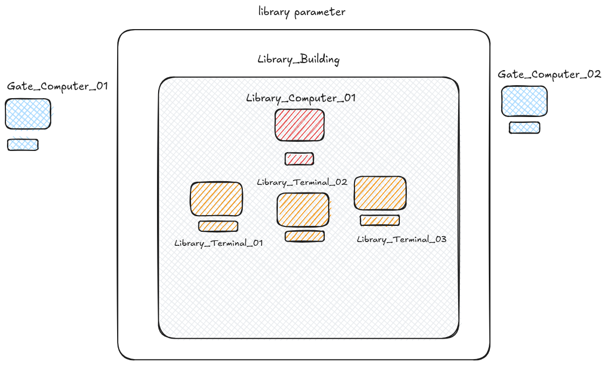

## Understanding Local Information Systems

**Local Information Systems** and **Local Area Networks** are useful whenever you need **speed**, **control**, **reliability**, or **privacy** without depending on the internet or cloud services. They are the backbone of systems where latency, uptime, or data sovereignty are non-negotiable.

---

## Core Value Propositions

| Driver | What It Enables |
|--------|-----------------|
| **Low latency** | Real-time control (factory automation, robotics, trading, gaming) |
| **Offline resilience** | Operations continue during WAN/internet outages |
| **Security & privacy** | Data stays on-premises; air-gapped and compliance-friendly |
| **Cost efficiency** | No cloud egress fees; reuse existing hardware; predictable costs |
| **Local control** | Full ownership of infrastructure, data, and configuration |

---

## Where They Shine

| Domain | Example Systems |
|--------|-----------------|
| **Industrial / OT** | SCADA, PLCs, CNC, factory automation |
| **Retail & logistics** | Offline POS, inventory, warehouse management |
| **Healthcare & legal** | On-prem records with data residency requirements |
| **Home & IoT** | Home Assistant, local MQTT, edge analytics |
| **Media & storage** | NAS, Plex/Jellyfin, local backups |
| **Development** | Local Git servers, CI/CD runners, staging labs |
| **Local AI / Edge** | Ollama, llama.cpp inference on LAN hardware |

---

## Local vs. Cloud — When to Choose What

| Requirement | Local Network/System | Cloud |
|-------------|:-------------------:|:-----:|
| Sub-10 ms response | ✅ | ❌ |
| Must work offline | ✅ | ❌ |
| Sensitive / regulated data | ✅ | ⚠️ |
| Huge data volumes (avoid egress) | ✅ | ❌ |
| Global access anywhere | ❌ | ✅ |
| Elastic scaling on demand | ❌ | ✅ |
| Zero in-house maintenance | ❌ | ✅ |

---

## Typical Local Information Systems

| System | Purpose |
|--------|---------|
| **NAS / file server** | Centralized storage, backups |
| **Local wiki / intranet** | Internal docs & knowledge base |
| **Local ERP / CRM** | Inventory, orders, customer data on-prem |
| **Local DNS / DHCP** | Network management (Pi-hole, dnsmasq) |
| **Monitoring stack** | Prometheus, Grafana, ELK |
| **Local chat / VoIP** | Matrix, Jitsi on LAN |
| **Embedded databases** | SQLite per-device local storage |

---

## Key Takeaway

Local networks and information systems are the right choice when you need **deterministic performance, offline resilience, data control, or cost predictability**. As edge computing and local AI grow, they are becoming *more* relevant—not less.

> **Design principle:** Use local systems for speed, sovereignty, and resilience; use the cloud for reach, elasticity, and managed operations. The strongest architectures combine both.
---

## Project Brief

1 km West of SunCity in the North West provice, sits a village called Raa. The locals have recently accired a small community library and they need your help, with creating a local information management system for registering people who go in and out of the library aand also keep trace of the books and who has what. Also create a website for the library with all the relevent information to keep the locals upto date.

*here is a map of the place and it's resources.*

outcomes:

- All 6 of the computers must have internet access
- Gate_Computers must use a CLI program for register visitors
- Library_Computer must have access to book database and visitors database
- Library_computer can manage other PCs on network
- Library_Terminals must be accessed by registered visitors ony
  
---

## Project Solution

### Glossary